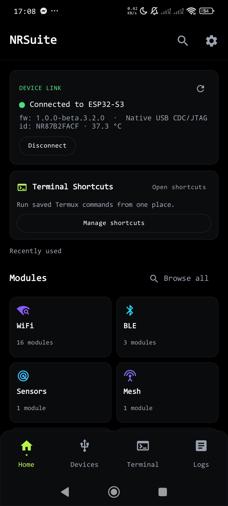
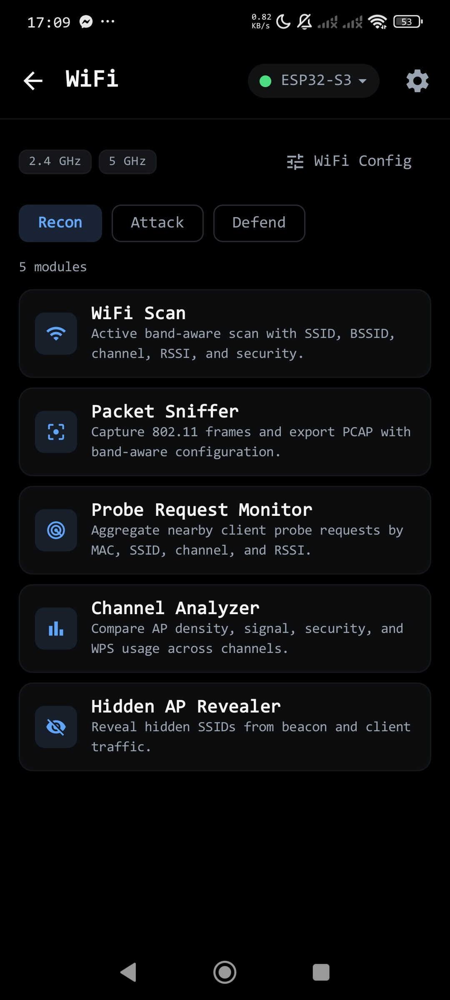
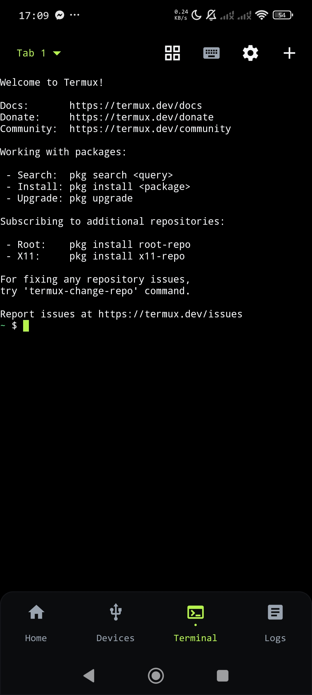
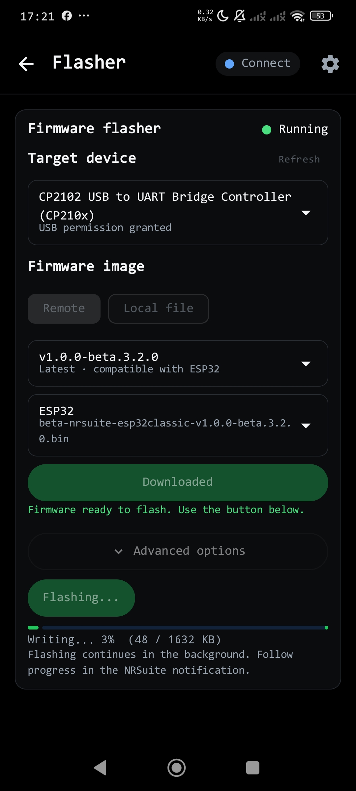
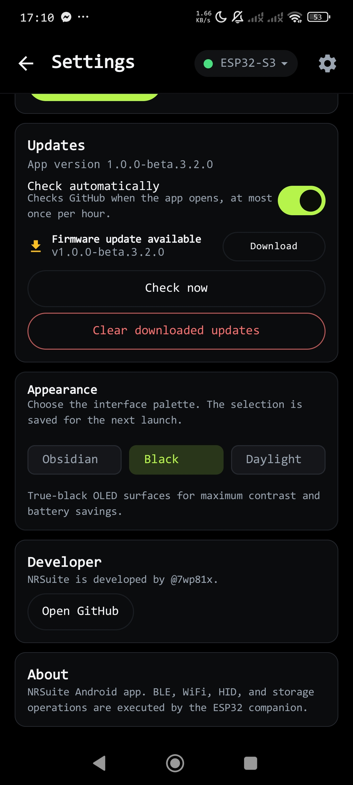

# NRSuite Documentation

Official guides, setup instructions, troubleshooting, protocol references, and
downloadable example resources for the **NRSuite Android app** and **ESP32
firmware**.

!!! warning "Authorized testing only"
    Use NRSuite only on networks, devices, and accessories you own or have
    explicit written permission to test. Active Wi-Fi, BLE, WPS,
    deauthentication, capture, portal, IR, BadUSB, and flashing features are
    intended for authorized security research and testing.

## Start here

| I want to... | Go to |
|---|---|
| Install the Android app | [Android installation](getting-started/installation.md) |
| Flash the ESP32 firmware | [Firmware flashing](firmware/flashing.md) |
| Learn the app workflows | [Android usage guide](android/usage-guide.md) |
| Set up the Termux SSH terminal | [Terminal guide](android/terminal-guide.md) |
| Download example files | [Resources and downloads](resources/index.md) |
| Read the wire protocol | [Protocol overview](protocol/overview.md) |

## Current release line

```text
Android:  1.0.0-beta.3.2.0
Firmware: 1.0.0-beta.3.2.0
Protocol: 1.0 / proto_minor 2, non-mesh
```

Download the matching builds from GitHub Releases:

- [NRSuite Android releases](https://github.com/7wp81x/NRSuite-Android/releases)
- [NRSuite firmware releases](https://github.com/7wp81x/NRSuite-firmware/releases)

## Screenshots

| Home | WiFi Recon | Terminal |
|---|---|---|
|  |  |  |

| Firmware Flasher | Themes |
|---|---|
|  |  |

## Project repositories

| Repository | Contents |
|---|---|
| [NRSuite-Android](https://github.com/7wp81x/NRSuite-Android) | Android companion app |
| [NRSuite-firmware](https://github.com/7wp81x/NRSuite-firmware) | ESP32 firmware |
| [NRSuite-Protocol](https://github.com/7wp81x/NRSuite-Protocol) | Wire protocol specification |
| [NRSuite-Docs](https://github.com/7wp81x/NRSuite-Docs) | This documentation and resource site |
